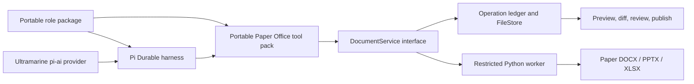

# Paper Instruments in Office Hum on Pi Durable

Date: 2026-10-14. Status: design approved in conversation; implementation and Linear reconciliation pending. Applies to Word, PowerPoint, and Excel work performed by every Office Hum role.

## Purpose and decisions

Office Hum will use Paper Instruments' Ultramarine 1 Flash as the default model for new role conversations, and its Paper Python forks as the Office document engine. Every role may receive both typed document tools and a restricted Python workspace. Pi Durable remains the only agent harness and the authority for conversation state, task checkpoints, approvals, and recovery. The Python worker executes bounded document operations; it never runs its own agent loop.

The selected shape is a **portable Paper Office tool pack plus a host-supplied document service**. The pack can be installed in a bare Pi Durable harness. Office Hum supplies a local document service backed by its FileStore, worker, review surface, and policy. A role receives only the tools and file leases granted for its task. Existing business documents are published only after a person reviews the exact proposed version; new documents can be saved as drafts automatically.

This extends the accepted [portable role design](../../design/agent-package.md): its prohibition on generic shell and file-writing tools remains, while a new, explicitly typed and sandboxed document-workspace capability is permitted. The package validator must distinguish this capability from an unrestricted shell or file writer. Role packages remain independent of `@officehum/office` and `@officehum/cli`.

## Evidence and integration constraints

- [Paper's Office libraries](https://www.paperinstruments.com/paper-python) are forks for Word, PowerPoint, and Excel work. Their current packages are `paper-docx`, `paper-pptx`, and `paper-xlsx`; they retain upstream Python import names. Pin exact versions in an isolated Python 3.13 worker image or environment, initially `paper-docx==0.2.0`, `paper-pptx==0.2.0`, and `paper-xlsx==0.2.1`, subject to reproducible install and format acceptance tests. Do not install them into a shared interpreter with their upstream packages.
- [Ultramarine 1 Flash](https://www.paperinstruments.com/ultramarine) is available through Paper's API; published model weights are described as forthcoming. The [API documentation](https://docs.paperinstruments.com/docs/ultramarine) specifies an OpenAI-compatible Chat Completions endpoint at `https://api.paperinstruments.com/v1`, tool calls, and `low`, `high`, or `max` reasoning effort. Paper's [Chat Completions guidance](https://docs.paperinstruments.com/docs/chat-completions) disallows `developer` messages. These are provider claims, so compatibility must be verified against the actual `pi-ai`/Pi Durable call and stream behavior before changing defaults.
- [Feather](https://github.com/paper-instruments/feather-train) demonstrates a Paper-centered office agent, but its harness and broad file/shell tools are not the Office Hum runtime. Its prompts, evaluations, and document patterns are useful references where licenses permit. [Paper Rubric](https://docs.paperinstruments.com/docs/rubric) can give qualitative review signals; it is not a substitute for deterministic integrity, formula, or numeric checks.
- Pi Durable's [checkpoint and replay model](https://earendil.com/posts/pi-durable/) remains authoritative. A replayed tool call must resolve to the same document operation and result. The document service therefore needs its own durable operation ledger and reconciliation; a Python subprocess alone cannot satisfy this contract.

The current CLI registers only an OpenAI provider, the Front Desk manifest defaults to an OpenAI model, and the current Python engine accepts scalar JSON requests with a short subprocess lifetime. This design adds a separate document service and workspace protocol rather than stretching that engine into an open-ended file editor. Existing PDF/CSV/email paths may continue independently; Paper Office owns `.docx`, `.pptx`, and `.xlsx` read, edit, and creation paths once each adapter passes its gate.

## Component boundary

**Model adapter.** Register a custom `pi-ai` provider named `paper` with model `ultramarine-1-flash`, `max` as its default reasoning effort, and a verified mapping to the three supported effort values. Configure its compatibility flag to emit system messages instead of `developer` messages. Keep API credentials in the host's credential callback; never expose them to a role tool or Python worker. Define the model in the role's settings/manifest as the default for *new* roots. A saved root resumes with its pinned provider/model and tool state; changing the default must not silently alter an unfinished conversation. An operator can choose an explicit alternative provider/model, but a failed Paper call does not silently switch providers because that could change tool semantics mid-task. Surface the failure and leave durable work resumable.

**Tool pack.** Provide `@officehum/tools-paper-office` (or the repo's equivalent portable package) as Pi Durable `defineTool` extensions. It depends on Pi Durable, `pi-ai`, and a small `DocumentService` interface, not the Office Hum host. Each role manifest can attach or withhold the tools. Office Hum injects the service, file leases, and review/publish policy; a bare Pi Durable harness can inject another implementation. The portability test runs the same role and tools with a fake service and with Office Hum's service. A tool name, argument schema, and replay classification must be explicit. The role's prompt can explain use, but all file access and publication rules are enforced by code.

**Service and worker.** `DocumentService` owns operation identity, leases, staging, validation, immutable versions, previews, and receipts. Its worker executes Python with fixed library versions and no ambient agent state. The worker has no network, host credentials, home directory, or general server filesystem. It receives read-only mounts or handles for leased input versions and one writable staging directory. Set bounded CPU, memory, wall time, output bytes, file count, and supported extension limits. Reject symlinks, traversal, zip bombs, and external relationships/links that would cause network or local-file reads. On systems where effective process isolation is unavailable, do not enable arbitrary Python workspace execution; typed tools can still run through a restricted adapter with equivalent isolation.

**FileStore and review.** FileStore records immutable `FileRef`s with file ID, version ID, format, content hash, size, creator/task, source version, and operation ID. It supports lookup by operation ID, staging/commit with uniqueness, and conditional publication against a current version. Preview/diff artifacts are derived from exact version hashes, not mutable paths. Review decisions are Pi Durable records bound to source and proposed hashes. FileStore is the byte/version authority; Pi Durable is the workflow and approval authority. The two are joined by stable operation IDs and reconciliation, not by assuming a cross-store transaction.

## Agent-facing contract

Expose small typed operations for `inspect_document`, `read_document`, `edit_document`, `create_document`, `preview_document`, `compare_document`, and `publish_document`. The precise surface can be format-specific where that improves validation: paragraph/table/comment/track-change operations for Word; slide/shape/text/layout operations for PowerPoint; sheet/range/formula/style/chart operations for Excel. Read and inspect results are bounded summaries with references to file IDs and previews; large document bodies must be paged. A tool never accepts an arbitrary server path. Inputs are file refs supplied by the task or returned by previous operations.

Expose `run_document_python` to every role as a separate capability when the role and task grant it. It runs submitted Python against a task-scoped workspace API and the three pinned Paper libraries. The role may open only its leased versions, write only staging outputs, and return declared output refs. The service rejects undeclared file effects. The workspace is for document transformations, not connector calls, shell access, package installation, model invocation, or long-running processes. It must have equivalent receipts and validation to typed tools. Typed tools are preferable for common edits because their schemas and diffs are easier to inspect; the Python workspace covers complex and cross-format transformations without introducing a second agent framework.

The task grants a lease listing input version IDs, permitted output formats, read/write scope, expiration, and maximum resource budget. A lease is bound to the Pi Durable task and role; it cannot be widened by prompt text, skill content, document content, or Python code. A workspace that needs another file requests a new lease through the host workflow. A role may attach the capability while receiving no usable lease for a particular task.

## Durable operation and file lifecycle

1. The host admits a task and pins each input to an immutable FileRef/version and hash. It grants a narrow file lease. All subsequent operations refer to these IDs, not filenames.
2. Every mutating tool call receives a stable operation ID derived from the Pi Durable task/conversation/call identity. The service binds that ID to canonical arguments or code hash, source version hashes, format, worker/library versions, and policy version. Reuse of the ID with changed intent fails closed.
3. The service checks its durable ledger before execution. If the same operation committed, it returns the same receipt and output refs. Otherwise it records a pending operation and runs on a copy of the latest *committed workspace revision*. A failed or refused edit leaves that revision and every source FileRef unchanged.
4. The worker writes only into staging. The service checks structure, reopens the result with the pinned library, verifies declared outputs, applies format-specific checks, and computes hashes. It atomically commits immutable output version(s) and a receipt in the file ledger. It then returns the receipt to Pi Durable. A crash between FileStore commit and Pi Durable tool settlement is reconciled by operation-ID lookup; it does not execute a second edit. A crash with only staging files either validates and commits the exact bound output or discards staging and re-executes against the same pinned source under the same ID.
5. A new workspace revision is visible only after the operation's receipt commits. Multiple edits to the same workspace are serialized or use revision compare-and-swap. Parallel independent document tasks can run concurrently. A stale edit gets a conflict result and must rebase or explicitly fork; it cannot overwrite a newer revision.
6. New documents enter FileStore as drafts automatically. Edits to an existing business document produce a proposed immutable version. `publish_document` first displays the exact source, proposed version, native diff, preview, and validation results to a person. The Pi Durable approval record binds those hashes and the target file ID. On approval, FileStore conditionally updates the published pointer only if the source remains current. A changed source produces a conflict and needs a fresh proposal/review. A denied or missing approval never publishes. Replaying an approved publish returns the same published version without a second pointer move.

An operation receipt contains source/output refs and hashes, format, operation ID, worker/library versions, validation results, and any refusal/error category. It never contains raw secrets or an unbounded dump of document content. The product can show a human a rich preview from stored artifacts; the model sees only the bounded tool response it needs. Retain proposal and review records for audit and recovery according to the office's retention policy.

## Format validation and review

Every output is reopened and checked as a valid Office package. Reject corrupt archives, unexpected files, macros/executable payloads, external relationships, unsupported format changes, and outputs above limits. For edits, compare critical structural parts of the source and output so unrelated content is preserved. A worker refusal is a typed, inspectable result and must leave source bytes unchanged.

| Format | Required evidence before draft or proposal commit | Review evidence for existing-file edits |
| --- | --- | --- |
| Word | Reopen; preserve package relationships and untouched sections; inspect comments/track changes where used | Text/structure diff and redline or tracked-change view tied to exact hashes |
| PowerPoint | Reopen; verify slide count/relationships/media; render each changed slide and inspect overflow | Slide order, shape/text/media diff and before/after slide previews |
| Excel | Reopen; verify sheet/range/formula references and changed-cell set; recalculate or report calculation limits | Cell/formula/style diff, affected dependencies, and explicit numeric checks |

Cross-format work carries a lineage of input and output refs. Numeric claims in a document or deck must trace to deterministic spreadsheet/code results rather than model arithmetic. Paper Rubric may flag layout, clarity, or visual quality, with its score recorded as optional evidence. It cannot approve publication or override integrity checks. If faithful rendering or recalculation is unavailable for a format feature, the result must disclose that limitation and require human inspection; it cannot claim those checks passed.

## Failure, security, and compatibility rules

- Idempotency spans Pi Durable retries and worker retries. A worker timeout, refusal, malformed output, validation failure, or lost response returns a stable error/receipt; it does not modify a source or published pointer. A transient error can be retried with the same operation ID and pinned inputs. An uncertain operation is reconciled from the ledger before a new execution.
- Documents and Python submitted by a model are untrusted input. Strip their text from control authority: embedded instructions cannot grant files, connectors, credentials, approvals, or publication. The worker isolation and service lease checks, not a system prompt, enforce the boundary.
- FileStore writes and publication are separate states. An approved review is not sufficient if the target version changed; conditional publication is required. An Office Hum restart must restore pending proposals and reviews through Pi Durable and operation lookup.
- The worker's package versions and image digest are recorded in receipts. Upgrades roll out through all-format fixtures and recovery tests; an in-flight task resumes with its pinned worker version or is explicitly migrated through a reviewed operation. Do not silently rerun a pending edit under new library semantics.
- A model provider failure, budget error, or interrupted stream leaves Pi Durable state intact. Provider adapter acceptance requires tool-call stream, usage accounting, abort, reasoning effort, and resumed conversation tests. No Paper-specific conversation state is hidden inside the document worker.
- Existing role overlays and model overrides remain supported. New defaults apply at root creation; persisted roots keep their configured provider/model. No existing business file is rewritten merely by enabling the tool pack.

## Delivery sequence and acceptance gates

1. **Provider.** Add the Paper `pi-ai` adapter, credentials callback, explicit model registration, new-root defaults, and provider compatibility tests. Gate: a bare Pi Durable conversation can stream tool calls and resume across an interruption with the same Ultramarine model configuration; default/override behavior is clear.
2. **File foundation.** Add immutable FileRefs/versions, operation-ID lookup and idempotent commit, task leases, workspace revisions, and conditional publish; build the isolated Python worker. Gate: crash/replay and concurrent edit tests prove no duplicate commits or silent overwrites, and sandbox tests prove files/network/credentials outside a lease are inaccessible.
3. **Paper Office adapters.** Ship typed Word, PowerPoint, and Excel tools plus the restricted Python workspace for every role. Add format fixtures covering read, create, edits to existing files, source-preserving refusal, and cross-format tasks. Gate: the portable pack runs in a bare Pi Durable harness and in Office Hum with equivalent receipts.
4. **Review and quality.** Add previews, native diffs, exact-hash approval, and publication UI/CLI. Gate: existing-file edits never publish without review; stale approvals conflict; Word/PPTX/XLSX reopen and deterministic checks pass; qualitative evaluations are recorded separately. Enable incrementally for roles after the all-format acceptance suite passes.

This is one architecture, with independently deliverable tickets. It does not require adopting Feather as a second harness, exposing arbitrary shell/file tools, deploying model weights, or replacing the office's non-Office document and connector paths.

## Linear reconciliation after spec review

Update the Office Hum project's existing issues rather than create parallel work. RASF-3199 remains the Tier 1 parent and should link this spec and the all-format acceptance criteria. RASF-3201 (document reading), RASF-3203 (document generation), and RASF-3204 (spreadsheet/data pack) need their Office format library choices changed from `mammoth`/`docx`/`exceljs` to Paper Office where applicable; keep their PDF, CSV, Typst, and DuckDB work as separate non-Paper concerns. RASF-3192/3193 need immutable version, operation lookup, workspace, and publish compare-and-swap requirements. RASF-3118 needs catalog/manifest support for typed tools and leased Python capability. RASF-3237 covers the Pi Durable/pi-ai upgrade prerequisite. RASF-3175 covers model-key handling.

Create focused issues under RASF-3199 where current tickets do not cover the work: Ultramarine provider and model default; restricted Paper Python worker/workspace; PowerPoint adapter; review/preview/publish flow; all-format portability and recovery acceptance. Link dependencies so the provider and FileStore foundations precede end-to-end rollout. Preserve existing issue ownership/status and unrelated scope. Reconcile titles, descriptions, labels, and dependencies against the live board when updating it; this section records intent, not a claim that Linear already changed.

## Open implementation decisions

The spec fixes authority and recovery boundaries. During planning, choose the concrete FileStore schema and storage backend, worker isolation mechanism for each supported platform, render/recalculation implementation, tool names and argument shapes, and the exact UI/CLI review presentation. Those choices must satisfy the receipts, lease, validation, portability, and publication contracts above. If a target platform cannot provide effective Python isolation or faithful format validation, gate that capability on that platform rather than weaken the contract.
